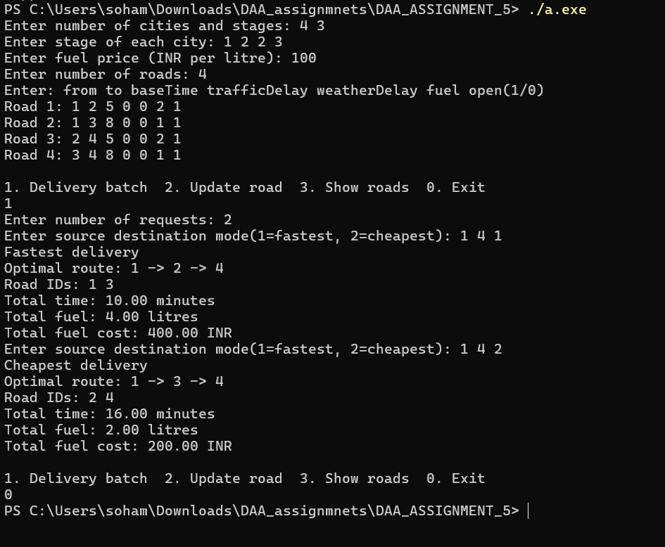

# DAA Assignment 5: SwiftCargo Multistage Delivery Optimization

## Description
This assignment implements **Dynamic Programming** in C++ to find the
**fastest** or **lowest fuel-cost** delivery route through a directed,
weighted multistage graph. It supports traffic and weather delays,
road closures, updated fuel estimates, and multiple delivery requests.
Every route advances to the next stage, ensuring that a delivery passes
through each predefined stage.

## Features
- **Dynamic Programming:** Computes an optimal route in O(V + E) time per request.
- **Two Optimization Modes:** Minimize travel time or fuel cost.
- **Road Updates:** Change travel time, traffic/weather delays, fuel usage,
  or open/closed status using the road ID.
- **Batch Processing:** Process multiple requests with the current road conditions.
- **Route Display:** Print the city path, road IDs, total time, fuel and fuel cost.
- **Adjacency Lists:** Use O(V + E) memory and support parallel roads.

## Files
- [SwiftCargo.cpp](SwiftCargo.cpp): Separate C++ source code.
- [Assignment report](DAA_Assignment_No_5_Soham_Kulkarni.pdf): Theory,
  pseudocode, complexity analysis and results; no C++ implementation.
- [Output screenshot](output.png): A sample run in Windows PowerShell.

## How to Run
Compile and run in Windows PowerShell:

```powershell
g++ -std=c++11 SwiftCargo.cpp -o SwiftCargo.exe
.\SwiftCargo.exe
```

On Linux/WSL:

```sh
g++ -std=c++11 SwiftCargo.cpp -o SwiftCargo
./SwiftCargo
```

## Input Format
1. Number of cities and stages.
2. Stage of each city, in city-ID order (IDs start at 1).
3. Fuel price in INR per litre.
4. Number of directed roads.
5. Each road as `from to baseTime trafficDelay weatherDelay fuel open`.

Times and delays are in minutes; fuel is in litres. Open is `1` for an
available road and `0` for a closed road. Road IDs follow input order.
Source must be in stage 1 and destination in the final stage. Each stage
must contain at least one city. All road values must be nonnegative.

### Menu
- `1`: Process a batch; enter the number of requests, then each request as
  `source destination mode` (`1` = fastest, `2` = cheapest).
- `2`: Update a road; enter its ID, then
  `baseTime trafficDelay weatherDelay fuel open`.
- `3`: Show all roads.
- `0`: Exit.

## Sample Input
This small example matches the output screenshot. Enter the values in order:

```text
4 3
1 2 2 3
100
4
1 2 5 0 0 2 1
1 3 8 0 0 1 1
2 4 5 0 0 2 1
3 4 8 0 0 1 1
1
2
1 4 1
1 4 2
0
```

## Sample Results
| Mode | Optimal route | Total time | Total fuel | Fuel cost |
| --- | --- | --- | --- | --- |
| Fastest | 1 -> 2 -> 4 | 10 minutes | 4 litres | 400 INR |
| Cheapest | 1 -> 3 -> 4 | 16 minutes | 2 litres | 200 INR |



## Complexity and Assumptions
- One delivery request: **O(V + E)** time.
- Batch of Q requests: **O(Q(V + E))** time.
- Total memory: **O(V + E)**.
- Road update by ID: **O(1)**; subsequent requests recompute their route.

Fastest mode uses base time + traffic delay + weather delay. Cheapest
mode uses estimated fuel litres * fuel price; tolls and other expenses
are excluded. Updates entered by the user simulate real-time conditions.
No live traffic/weather feed is connected. Conditions remain fixed within
a batch, and requests are optimized independently. All sample values are
illustrative. Invalid input terminates with an error message.
